# PersonalCRM — как это будет выглядеть

> Один документ для обсуждения: посмотреть, понять и сказать «да» или «нет» по каждому пункту. Читать по порядку, 15–20 минут.
## Оглавление

1. [Идея и зачем это нужно](#1-идея-и-зачем-это-нужно)
2. [Экраны и вкладки](#2-экраны-и-вкладки)
3. [Как этим пользоваться — сценарии](#3-как-этим-пользоваться--сценарии)
4. [Как это устроено внутри](#4-как-это-устроено-внутри)
5. [План работ](#5-план-работ)
6. [Решения: да / нет](#6-решения-да--нет)


## В одном абзаце

Одна записная книжка вместо Outlook, Google Контактов и заметок в телефоне. Контакты сами подтягиваются из Outlook, Google и телефона. Про каждого человека хранится всё нужное: кто он, о чём говорили, **что хотели у него спросить и что он ответил**, когда следующая встреча. Заполнять анкеты не нужно: достаточно сказать или написать ИИ обычными словами — «встретил Петю, дочке 5 лет, переезжает в Дубай, напомни позвонить в пятницу». Он сам разложит всё по полочкам и поставит задачу в календарь.

## Карта продукта

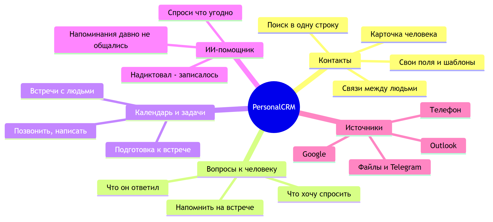

## Главный принцип

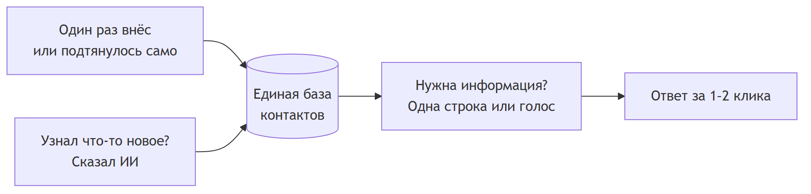

---

# 1. Идея и зачем это нужно


## Проблема

Контакты разбросаны по разным местам, и ни одно из них не помнит главного — **контекст отношений**.

| Где сейчас | Что хорошо | Что плохо |
|---|---|---|
| **Outlook** | Рабочие контакты, календарь, синхронизация с телефоном | Карточка жёсткая: имя, телефон, компания и поле «Заметки». Неудобно искать по смыслу |
| **Контакты телефона / Google** | Всегда под рукой, звонилка | Только телефоны и почта, контекста нет |
| **Заметки** | Можно записать что угодно | Не привязаны к человеку, через месяц ничего не найти |
| **Notion** | Можно построить что угодно | Сначала надо самому придумать структуру, таблицы, свойства. Долго и «душно», неудобно с телефона |
| **Голова** | Быстро | Забывается: «как зовут его жену?», «о чём договорились в прошлый раз?» |

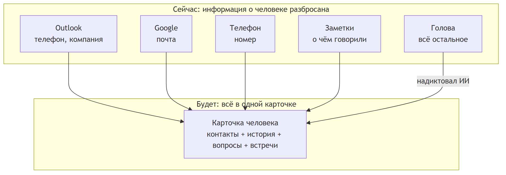

## Решение

1. **Одна база.** Контакты сами подтягиваются из Outlook, Google и телефона, дубли склеиваются.
2. **Гибкая карточка без «душности».** Есть готовые шаблоны («Клиент», «Партнёр», «Друг», «Родственник»). Своё поле добавляется в один клик, а ИИ может добавить его сам.
3. **Вопросы к человеку.** Отдельный список «что хочу спросить» с ответами. Перед встречей он сам всплывает.
4. **Календарь и задачи.** «Позвонить в пятницу», «встреча во вторник» — привязаны к человеку и лежат в обычном календаре Outlook или Google.
5. **ИИ-помощник.** Заполнять формы не нужно: говоришь или пишешь обычными словами, он раскладывает всё по полям и отвечает на вопросы о людях.
6. **Всё на своей машине.** Данные и ИИ (своя модель Qwen) никуда не уходят.

## Конкуренты

| Продукт | Что умеет | Чего не хватает |
|---|---|---|
| **Mesh** (бывший Clay) | Сам собирает контакты из почты и соцсетей, ИИ-поиск | Карточку почти нельзя настроить, данные в чужом облаке |
| **Dex** | LinkedIn, уведомления «сменил работу», напоминания | Заточен под LinkedIn, платный, ИИ-доступ только на дорогом тарифе |
| **folk** | Гибкие поля, работа в команде | Это CRM для отдела продаж, для одного человека тяжеловато |
| **Covve** | Удобное приложение, сканер визиток | Мало гибкости |
| **Monica** | Бесплатный, ставится к себе | Нет синхронизации с почтой и календарём, нет приложения, всё вручную |
| **Notion** | Любая структура | Всё строить самому, нет синхронизации контактов |

**Ни у кого нет связки «вопрос к человеку → ответ → встреча в календаре»** и ни у кого нет упора на «надиктовал — оно само записалось».

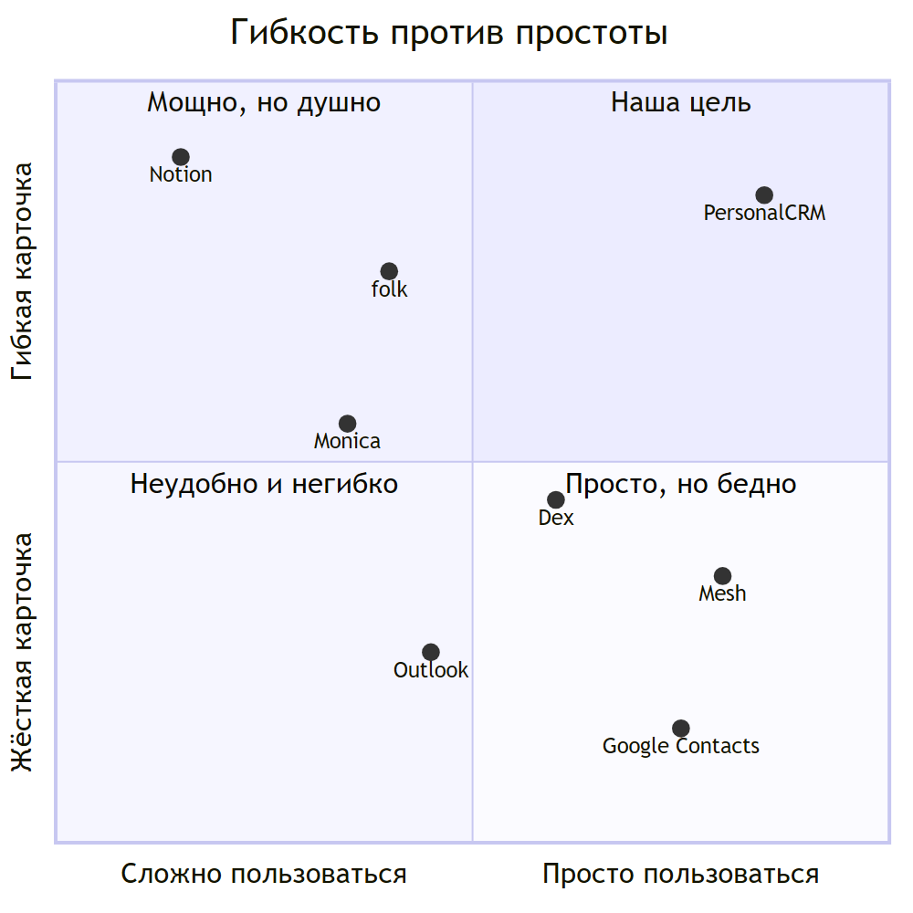

## Чем мы отличаемся

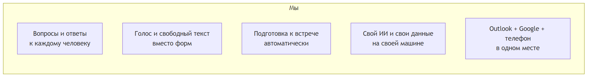


---

# 2. Экраны и вкладки


> Эскизы схематичные: показывают **что** будет на экране, а не точный дизайн.
> На компьютере вкладки слева, на телефоне — внизу экрана.

## Карта экранов

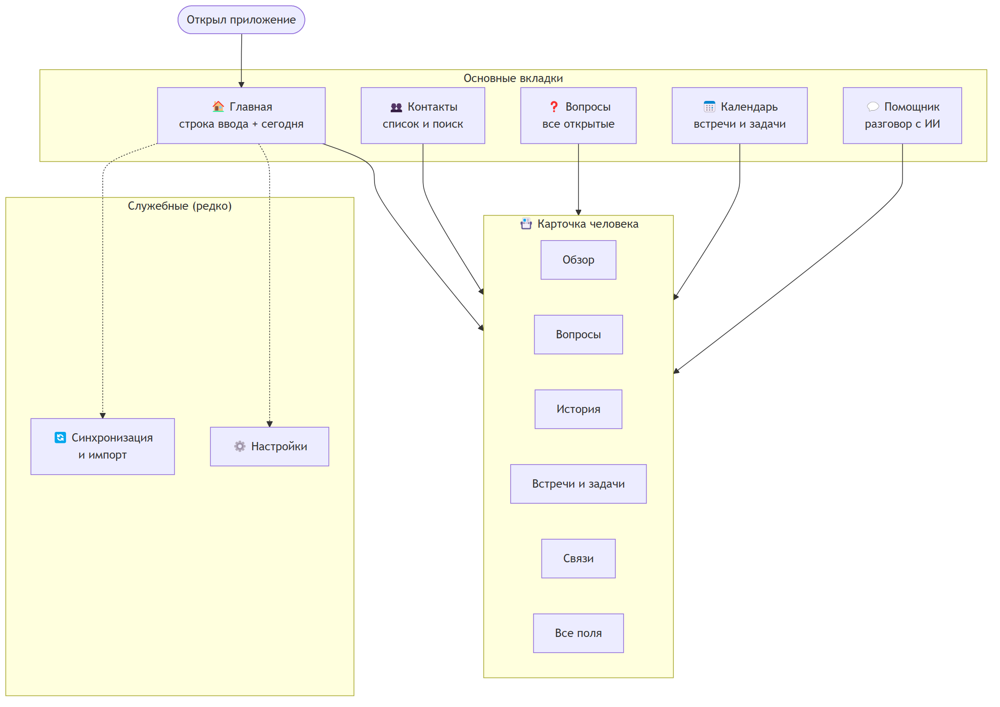

**Правило:** из любого места до карточки человека — **один клик**, до любого факта о нём — **не больше двух**.

---

## 🏠 Вкладка «Главная»

Экран, который видишь каждый день. Главный элемент — **одна строка**, которая одновременно ищет, отвечает на вопросы и записывает новое.

```
┌──────────────────────────────────────────────────────────────────┐
│  🔍  Найти, спросить или записать…                        🎤      │
│      «Петя»  •  «кто у меня в Дубае?»  •  «встретил Петю, …»      │
├──────────────────────────────────────────────────────────────────┤
│                                                                  │
│  СЕГОДНЯ, вторник 21 октября                                     │
│  ┌────────────────────────────────────────────────────────────┐  │
│  │ 10:00  Встреча с Петром Ивановым (ООО «Альфа»)             │  │
│  │        ❓ 2 вопроса: как прошёл переезд? сроки по проекту?  │  │
│  │ 15:30  📞 Позвонить Марине — поздравить с повышением        │  │
│  │ 18:00  ✅ Отправить Сергею презентацию                      │  │
│  └────────────────────────────────────────────────────────────┘  │
│                                                                  │
│  🎂 ДНИ РОЖДЕНИЯ           │  ⏳ ДАВНО НЕ ОБЩАЛИСЬ               │
│  • Анна К. — сегодня       │  • Олег Б. — 4 месяца               │
│  • Дмитрий С. — в пятницу  │  • Ирина М. — 3 месяца              │
│                            │  • Виктор П. — 3 месяца             │
│                                                                  │
│  🕘 НЕДАВНИЕ: Пётр И. · Марина Л. · Сергей Т. · Анна К.           │
└──────────────────────────────────────────────────────────────────┘
```

| Блок | Что делает |
|---|---|
| **Строка ввода** | Ввёл имя → сразу список подходящих людей. Задал вопрос → ответ ИИ. Написал или сказал факт → предпросмотр «что запишу», одна кнопка «Сохранить» |
| **🎤 Микрофон** | То же самое голосом |
| **Сегодня** | Встречи и задачи из календаря. У встречи сразу видны открытые вопросы к этому человеку |
| **Дни рождения** | Ближайшие 7 дней |
| **Давно не общались** | Важные люди, с которыми не было контакта дольше заданного срока (срок настраивается для каждого человека или категории) |
| **Недавние** | Последние открытые карточки — вернуться в один клик |

---

## 👥 Вкладка «Контакты»

Список всех людей с быстрым поиском и фильтрами.

```
┌──────────────────────────────────────────────────────────────────┐
│  🔍 Поиск…            [Шаблон ▾] [Категория ▾] [Город ▾] [Ещё ▾]  │
│  Вид: ☰ список  ▦ таблица        Сортировка: последний контакт ▾  │
├──────────────────────────────────────────────────────────────────┤
│  ★ Пётр Иванов      Директор, ООО «Альфа»   Москва   ❓2  📅вт   │
│    Марина Лебедева  Юрист, «Бета Групп»     Москва         5 дн │
│  ★ Сергей Титов     Партнёр                 Дубай    ❓1   2 нед │
│    Анна Козлова     Друг семьи              СПб      🎂сегодня  │
│    Олег Борисов     Поставщик               Казань        4 мес │
│    …                                                             │
│  ─────────────────────────────────────────────────────────────── │
│  Всего: 1 284   •  Outlook 912 · Google 301 · Телефон 71          │
└──────────────────────────────────────────────────────────────────┘
```

- **Значки в строке:** ★ — важный, ❓2 — открытые вопросы, 📅 — ближайшая встреча, 🎂 — день рождения, справа — сколько прошло с последнего контакта.
- **Фильтры:** шаблон (Клиент / Партнёр / Друг…), категория, город, компания, теги, приоритет, «есть открытые вопросы», «давно не общались», источник.
- **Табличный вид:** как Excel — колонки выбираются, включая свои поля. Удобно для массовой правки.
- **Сохранённые фильтры:** например «Клиенты в Москве» или «Партнёры без контакта 3+ месяца» — одна кнопка.

---

## 📇 Карточка человека

Сердце продукта. Шапка всегда наверху, ниже — подвкладки.

```
┌──────────────────────────────────────────────────────────────────┐
│  [фото]  ★ ПЁТР ИВАНОВ                       Шаблон: Партнёр     │
│          Директор, ООО «Альфа» · Москва                          │
│          📞 Позвонить   ✉ Написать   📅 Встреча   ✅ Задача       │
│          Последний контакт: 12 дней назад · Источники: Outlook   │
├──────────────────────────────────────────────────────────────────┤
│  [Обзор]  Вопросы ❓2  История  Встречи и задачи  Связи  Все поля │
├──────────────────────────────────────────────────────────────────┤
│  ГЛАВНОЕ                                                         │
│  Семья: жена Ольга, дочь Маша (5 лет)                            │
│  Интересы: рыбалка, теннис                                       │
│  Важно: переезжает в Дубай в декабре                             │
│                                                                  │
│  📌 ЗАКРЕПЛЕНО                                                   │
│  «Не любит звонки до 11:00, лучше писать в Telegram»             │
│                                                                  │
│  ❓ ОТКРЫТЫЕ ВОПРОСЫ                    📅 БЛИЖАЙШЕЕ              │
│  • Как прошёл переезд?                 вт 10:00 — встреча        │
│  • Сроки по проекту «Север»?           пт — позвонить            │
│                                                                  │
│  🎤 «Добавить про Петра…»                                         │
└──────────────────────────────────────────────────────────────────┘
```

### Подвкладки карточки

| Подвкладка | Что внутри |
|---|---|
| **Обзор** | Самое важное на одном экране: ключевые поля шаблона, закреплённые заметки, открытые вопросы, ближайшие встречи и задачи. Внизу строка «добавить про этого человека» (текст или голос) |
| **Вопросы** | Все вопросы к человеку: открытые сверху, отвеченные ниже с датой и ответом. Каждому вопросу можно поставить «спросить на следующей встрече» или конкретную дату |
| **История** | Лента событий по датам: встречи, звонки, заметки, изменения полей («сменил компанию»), ответы на вопросы. Видно, кто внёс запись: вы, ИИ или синхронизация |
| **Встречи и задачи** | Прошлые и будущие встречи из календаря, задачи «позвонить / написать / отправить». Создать новую в один клик |
| **Связи** | Кто с кем связан: «жена — Ольга Иванова», «коллега — Марина Л.», «познакомил — Сергей Т.». Связанные люди — тоже карточки |
| **Все поля** | Полный список полей: стандартные (телефоны, почта, адрес, ДР), поля шаблона и свои. Видно, откуда каждое значение (Outlook, Google, вручную, ИИ) |

### Вопросы к человеку — как устроены

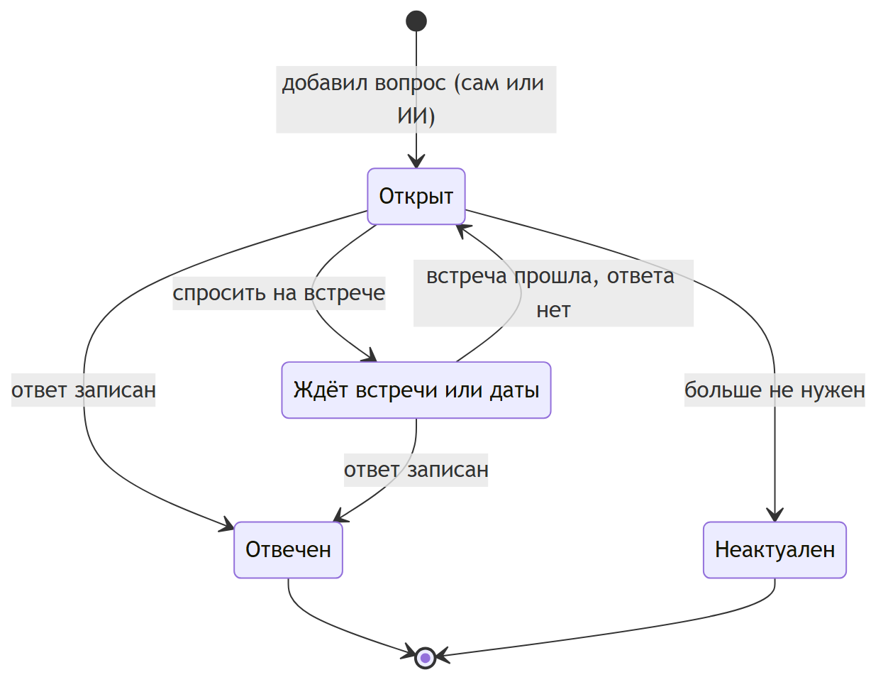

---

## ❓ Вкладка «Вопросы»

Все открытые вопросы по всем людям — удобно перед неделей встреч.

```
┌──────────────────────────────────────────────────────────────────┐
│  Группировать: [к ближайшим встречам ▾]    Показать отвеченные ☐ │
├──────────────────────────────────────────────────────────────────┤
│  📅 ВТ 10:00 — Пётр Иванов                                        │
│     ☐ Как прошёл переезд?                                         │
│     ☐ Сроки по проекту «Север»?                                   │
│  📅 ЧТ 14:00 — Марина Лебедева                                    │
│     ☐ Кто у них отвечает за закупки?                              │
│  ─── без встречи ────────────────────────────────────────────── │
│  Сергей Титов   ☐ Какая школа у сына в Дубае?                     │
│  Олег Борисов   ☐ Новые цены на 2027?           [📅 Назначить]    │
└──────────────────────────────────────────────────────────────────┘
```

- Группировка: **к ближайшим встречам**, по людям или по тегам («бизнес», «личное»).
- Отметить вопрос отвеченным прямо отсюда: всплывает поле «ответ».
- У вопроса без встречи есть кнопка «Назначить встречу / звонок».

---

## 📅 Вкладка «Календарь»

Это **не новый календарь**, а окно в ваш Outlook или Google Календарь, где видно людей.

```
┌──────────────────────────────────────────────────────────────────┐
│  ◀ Неделя 20–26 октября ▶                   [День] [Неделя] [Задачи]│
├────────┬─────────┬─────────┬─────────┬─────────┬─────────┬───────┤
│  Пн 20 │  Вт 21  │  Ср 22  │  Чт 23  │  Пт 24  │  Сб 25  │ Вс 26 │
├────────┼─────────┼─────────┼─────────┼─────────┼─────────┼───────┤
│        │10:00    │         │14:00    │📞 Пётр  │         │       │
│        │Пётр И.  │         │Марина Л.│         │🎂 Дима  │       │
│        │ ❓2     │         │ ❓1     │         │         │       │
└────────┴─────────┴─────────┴─────────┴─────────┴─────────┴───────┘
│  ЗАДАЧИ: ☐ Отправить Сергею презентацию (сегодня)                │
│          ☐ Позвонить Петру (пт)   ☐ Поздравить Диму (сб)          │
└──────────────────────────────────────────────────────────────────┘
```

- Встречи и задачи **создаются в вашем Outlook или Google** — видны на телефоне, в часах и везде, где вы уже ими пользуетесь.
- В описание встречи автоматически добавляется блок **«Что спросить»** с открытыми вопросами к участникам.
- Клик по встрече → карточка человека.
- Задачи: Microsoft To Do или Google Tasks, с привязкой к человеку.

---

## 💬 Вкладка «Помощник» (ИИ)

Разговор с ИИ о ваших контактах. Та же строка, что на главной, но с историей разговора.

```
┌──────────────────────────────────────────────────────────────────┐
│  Вы:  Встретил Петю Иванова. Дочке Маше 5 лет, в декабре         │
│       переезжают в Дубай. Надо позвонить ему в пятницу            │
│       насчёт проекта Север.                                       │
│                                                                  │
│  ИИ:  Записываю в карточку Петра Иванова:                         │
│       ┌──────────────────────────────────────────────────────┐   │
│       │ ✏️ Семья: дочь Маша (5 лет)               [добавить]   │   │
│       │ ✏️ Важно: переезд в Дубай, декабрь        [добавить]   │   │
│       │ ✅ Вопрос «Как прошёл переезд?» → закрыть? [да / нет]  │   │
│       │ 📅 Задача: позвонить, пт 24.10, «проект Север»         │   │
│       │ 📝 Заметка о встрече 21.10                             │   │
│       └──────────────────────────────────────────────────────┘   │
│       [✔ Сохранить всё]   [Изменить]   [Отмена]                   │
│                                                                  │
│  Вы:  Кто из моих знакомых живёт в Дубае?                         │
│  ИИ:  Трое: Сергей Титов, Пётр Иванов (с декабря), Алия Р.        │
├──────────────────────────────────────────────────────────────────┤
│  Написать или сказать…                                    🎤  ➤  │
└──────────────────────────────────────────────────────────────────┘
```

- **ИИ ничего не меняет без подтверждения:** сначала показывает предпросмотр, вы жмёте «Сохранить».
- Понимает сокращения и имена («Петя» → Пётр Иванов). Если людей с таким именем несколько, переспрашивает.
- Примеры вопросов: «когда я последний раз говорил с Мариной?», «что я обещал Олегу?», «кого пригласить на рыбалку?», «у кого день рождения в ноябре?».
- Работает на **своей модели Qwen** — разговоры и данные никуда не уходят.

---

## 🔄 Синхронизация и импорт

Служебный экран: подключить источники и забыть о них.

```
┌──────────────────────────────────────────────────────────────────┐
│  ИСТОЧНИКИ                                                       │
│  ✅ Outlook (ivanov@company.ru)   912 контактов  ⟳ 5 мин назад   │
│  ✅ Google (ivanov@gmail.com)     301 контакт    ⟳ 5 мин назад   │
│  ⬜ Телефон (CardDAV)             [Подключить]                    │
│                                                                  │
│  ИМПОРТ ФАЙЛА:  [CSV]  [vCard]  [Telegram]                       │
│                                                                  │
│  ⚠ ВОЗМОЖНЫЕ ДУБЛИ: 7                              [Разобрать]   │
│     «Пётр Иванов» (Outlook) ↔ «Петя Иванов» (Google) — 84%       │
│                                                                  │
│  ИСТОРИЯ: 21.10 10:05  Outlook: +3 новых, 5 обновлено             │
└──────────────────────────────────────────────────────────────────┘
```

- **Двусторонняя синхронизация:** поправил телефон в CRM — он поменялся и в Outlook, и на телефоне.
- **Дубли:** явные склеиваются сами, сомнительные показываются для решения «склеить / оставить отдельно».

---

## ⚙️ Настройки

| Раздел | Что настраивается |
|---|---|
| **Шаблоны карточек** | Готовые: Клиент, Партнёр, Друг, Родственник, Сотрудник. Можно поправить или создать свой: какие поля и в каком порядке показывать в «Обзоре» |
| **Свои поля** | Тип поля: текст, дата, число, список вариантов, ссылка, «да/нет». Поля, которые придумал ИИ, попадают сюда на подтверждение |
| **Категории и теги** | Свои категории, цвета |
| **Напоминания** | «Давно не общались»: срок для категорий (например, партнёры — 2 месяца, друзья — 3); за сколько напоминать о днях рождения |
| **ИИ** | Какая модель (своя Qwen), запасной вариант (выключен), язык, сохранять ли историю разговоров |
| **Безопасность** | Пароль, резервные копии (когда и куда), экспорт всех данных |

---

## 📱 На телефоне

То же самое, но вкладки внизу экрана, а микрофон — большая кнопка по центру.

```
┌─────────────────────────┐
│ 🔍 Найти или записать…  │
├─────────────────────────┤
│ СЕГОДНЯ                 │
│ 10:00 Пётр И.  ❓2      │
│ 15:30 📞 Марина         │
│                         │
│ 🎂 Анна К. — сегодня    │
│ ⏳ Олег Б. — 4 мес      │
│                         │
├─────────────────────────┤
│ 🏠   👥   (🎤)   ❓   📅 │
└─────────────────────────┘
```

На первом этапе это сайт, который открывается в браузере телефона и добавляется на экран как приложение (PWA). Отдельное приложение из App Store / Google Play — позже и только если понадобится.


---

# 3. Как этим пользоваться — сценарии


Шесть типичных ситуаций — как они выглядят в жизни и что происходит «под капотом».

---

## Сценарий 0. Первый запуск (один раз)

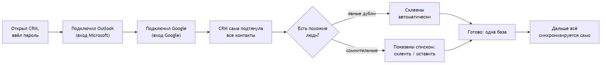

Это **10–15 минут один раз**. Дальше ничего настраивать не нужно.

---

## Сценарий 1. После встречи — «надиктовал и забыл»

Вышел со встречи, в машине нажал микрофон и сказал:

> «Встретил Петю Иванова. Дочке Маше пять лет, в декабре переезжают в Дубай. На вопрос про сроки сказал — до конца марта. Позвонить ему в пятницу насчёт договора».

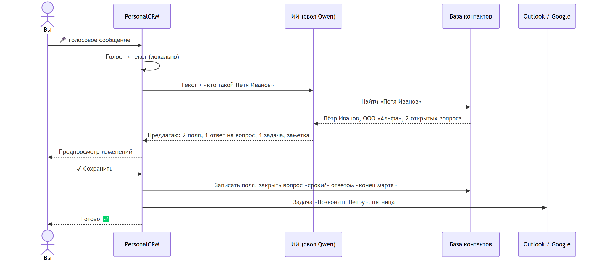

**Итог:** 1 нажатие на микрофон + 1 нажатие «Сохранить». Никаких форм.

---

## Сценарий 2. Перед встречей — «что я хотел спросить?»

Ничего делать не нужно — CRM готовит сама.

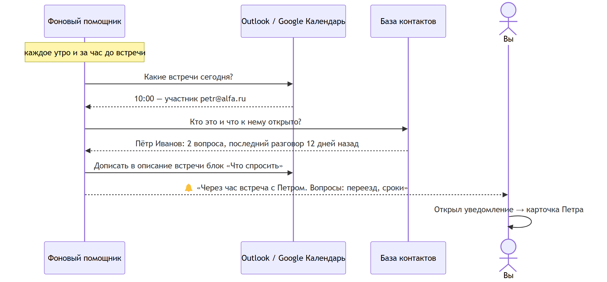

Блок «Что спросить» виден прямо в Outlook на телефоне — даже без открытия CRM.

---

## Сценарий 3. Быстрый вопрос — «как зовут жену Олега?»

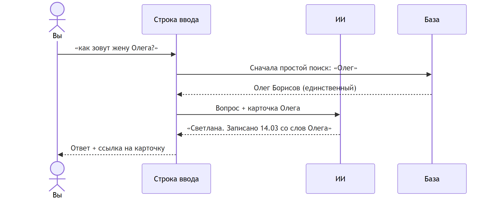

**Итог:** напечатал или сказал фразу — получил ответ. Ноль кликов по меню.

Другие примеры вопросов:

| Вопрос | Что ответит |
|---|---|
| «Кто у меня в Дубае?» | Список людей с городом Дубай + кто туда переезжает |
| «Что я обещал Сергею?» | Заметки и задачи, где упоминается обещание |
| «С кем из партнёров давно не говорил?» | Список с датами последнего контакта |
| «Кому можно позвонить насчёт юриста?» | Люди с профессией или пометками про юристов |
| «У кого ДР в ноябре?» | Список с датами |

---

## Сценарий 4. Новый человек на ходу

Познакомился на выставке, есть визитка.

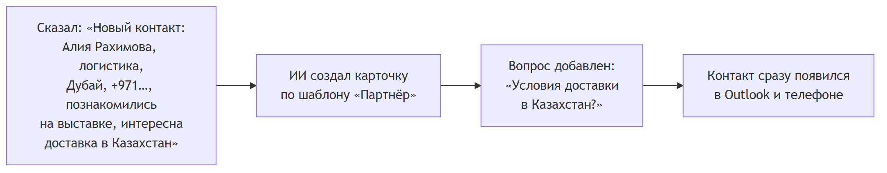

Позже: фото визитки → карточка (этап «потом», см. [план](#5-план-работ)).

---

## Сценарий 5. «Давно не общались»

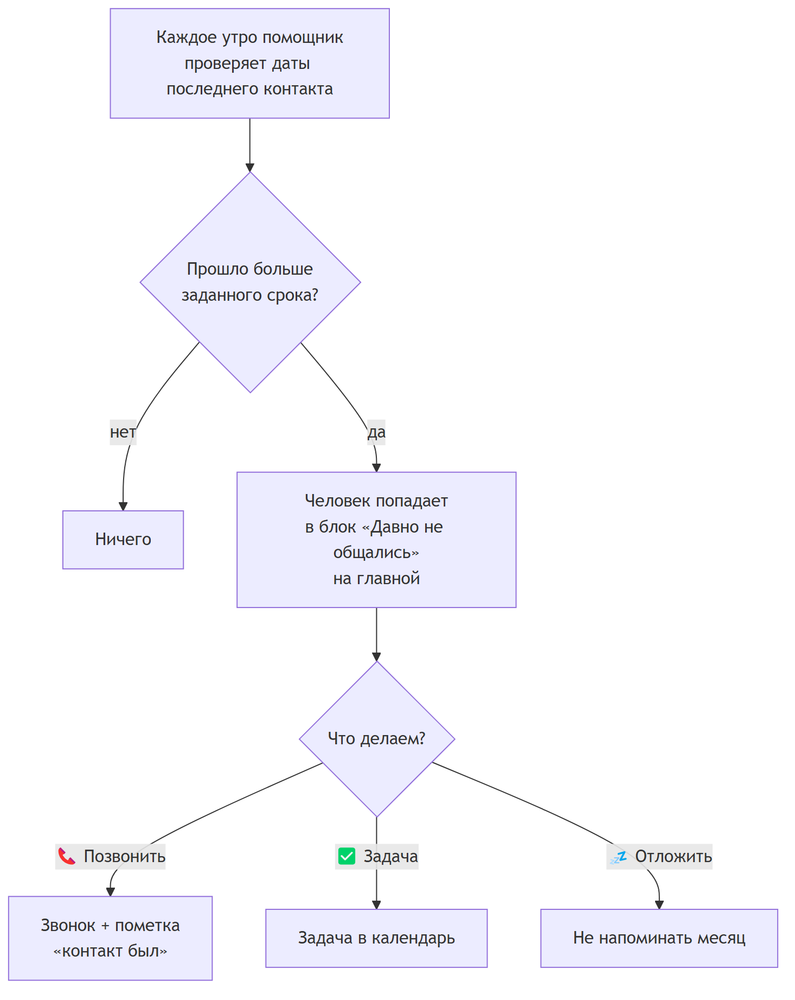

«Последний контакт» обновляется сам: по встречам в календаре, по заметкам и по пометке «звонил».

---

## Сценарий 6. Правка в одном месте — везде

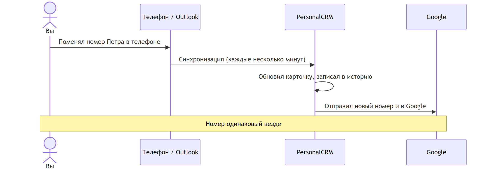

---

## Один день с CRM

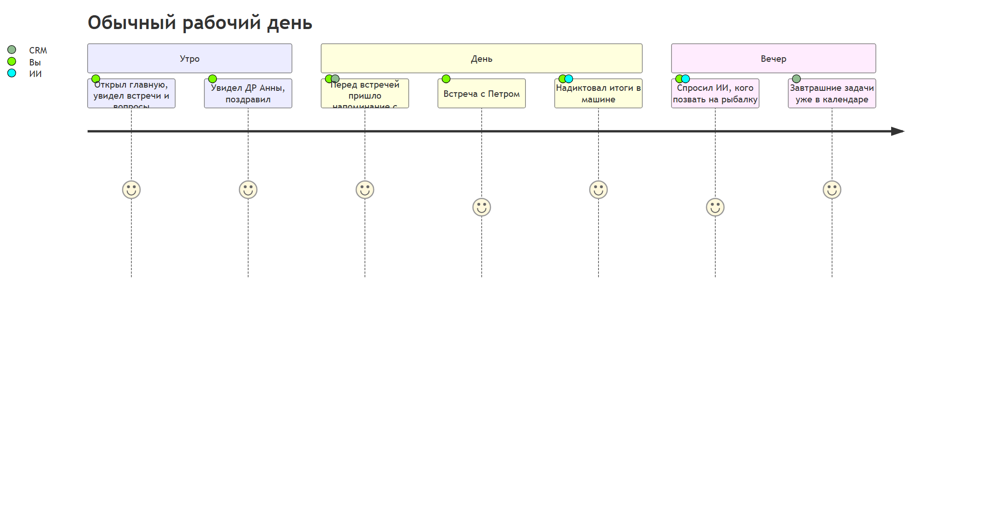


---

# 4. Как это устроено внутри


> Этот раздел — для понимания «где лежат данные и кто их видит». Технические детали — в [rethink_2026-10.md](../rethink_2026-10.md) и [contact_sync_architecture.md](../contact_sync_architecture.md).

## Общая схема

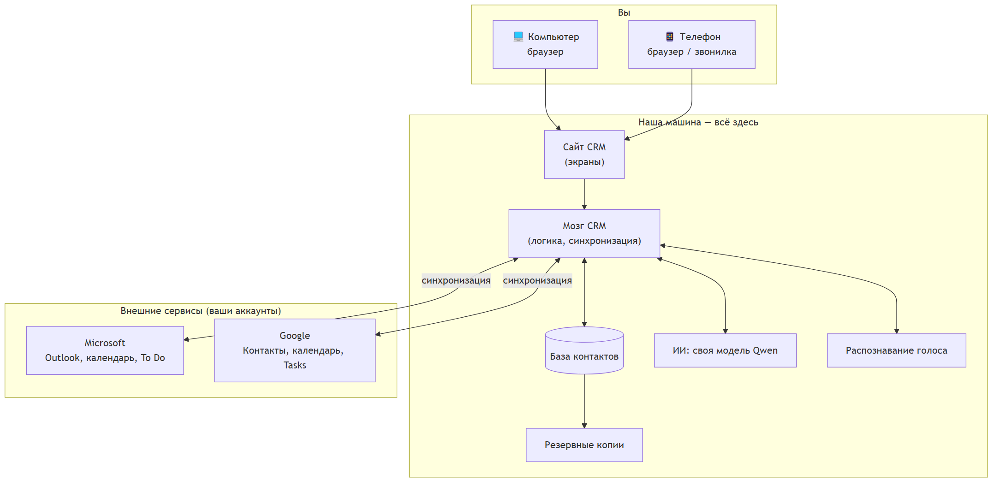

**Главное:** база и ИИ работают на нашей машине. Наружу уходят только сами контакты и события — в ваши же Outlook и Google, как и сейчас.

## Два этапа размещения

Сначала делаем и проверяем всё на рабочем компьютере, потом переносим на машину-сервер.

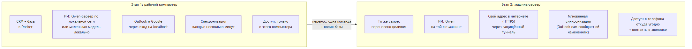

| | Этап 1: рабочий компьютер | Этап 2: машина-сервер |
|---|---|---|
| Где работает | Этот ПК | Машина с Qwen |
| Доступ | Только с этого ПК | С любого устройства, через интернет по паролю |
| Outlook / Google | Работают | Работают |
| Скорость синхронизации | Раз в несколько минут | Почти мгновенно |
| Телефон | Нет | Да (сайт + контакты в звонилке) |
| ИИ | Qwen по сети или маленькая модель | Qwen на месте |
| Подключение Claude / ChatGPT | Нет | Да (позже) |

## Как ИИ разбирает сказанное

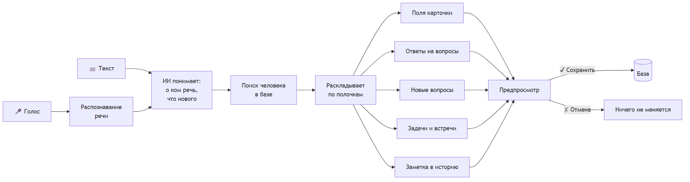

ИИ **никогда не меняет данные сам** — только предлагает. Решение всегда за вами.

## Почему своя модель, а не ChatGPT

| | Своя модель (Qwen) — **выбрано** | ChatGPT / Claude через интернет |
|---|---|---|
| Где данные | Не покидают нашу машину | Уходят в американскую компанию |
| Стоимость | Бесплатно (машина уже есть) | Оплата за каждый запрос |
| Качество | Хватает для наших задач: разобрать текст, найти, ответить | Выше, но для этих задач избыточно |
| Работа без интернета | Да (на этапе 2) | Нет |
| Голос с телефона через приложение ChatGPT / Claude | Добавим отдельно позже | Есть |

Запасной вариант: если своя модель с чем-то не справится, можно включить Claude одной настройкой. По умолчанию выключено.

## Что хранится — схема данных

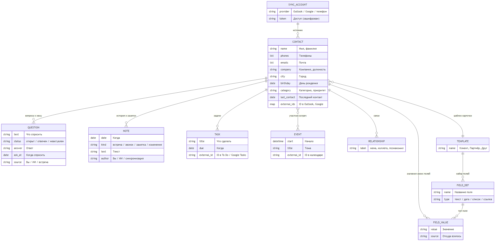

## Синхронизация: откуда приходят контакты

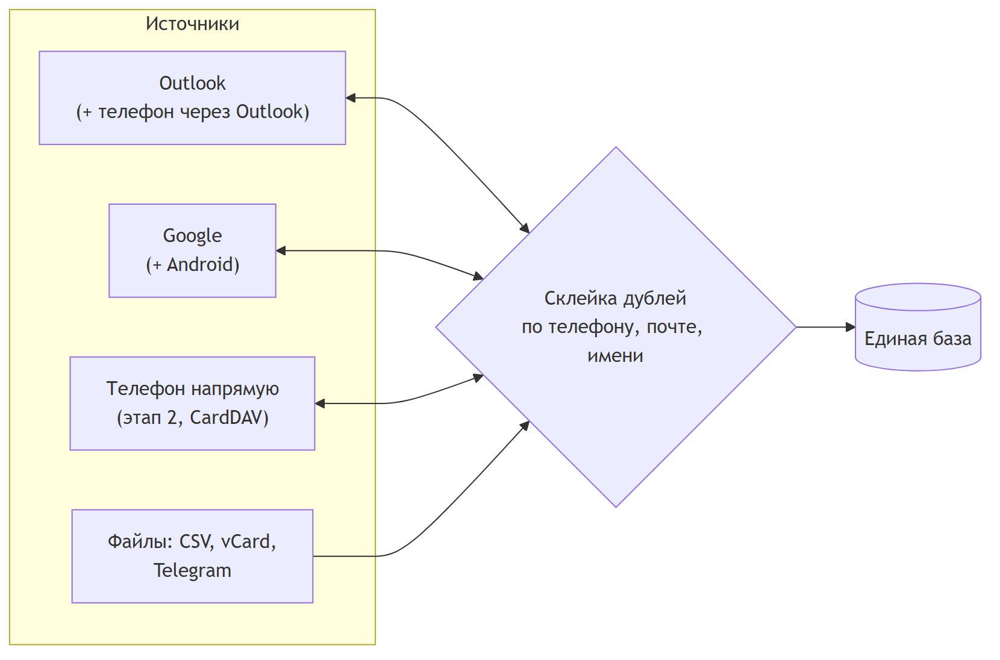

- **Двусторонняя:** правка в CRM уходит обратно в Outlook и Google.
- **Без потерь:** если контакт удалён в Outlook, в CRM он не удаляется молча (это решение можно поменять — см. [анкету](#6-решения-да--нет)).
- **Уже готово:** код синхронизации с Outlook, Google и импорт файлов написан и проверен тестами. Осталось подключить реальные аккаунты.

## Безопасность

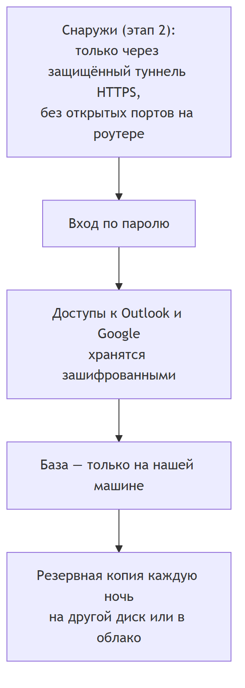


---

# 5. План работ


> Сроки ориентировочные: этап ≈ 2 недели. Порядок важнее дат.

## Что уже сделано

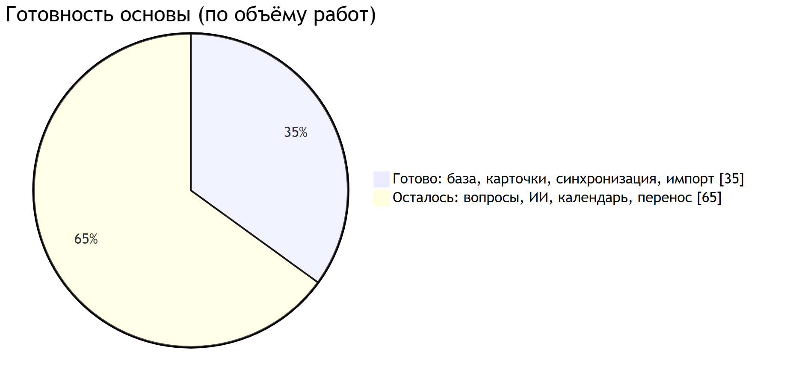

| ✅ Готово | Что это значит |
|---|---|
| База контактов, карточки, поиск, вход по паролю | Можно вручную вести контакты |
| Синхронизация с Outlook и Google (в обе стороны) | Код написан и проверен на тестах; нужно подключить реальные аккаунты |
| Импорт из CSV, vCard, Telegram | Работает |
| Склейка дублей | Работает: явные — сами, сомнительные — на выбор |
| Фоновое обновление по расписанию | Работает |

## Этапы

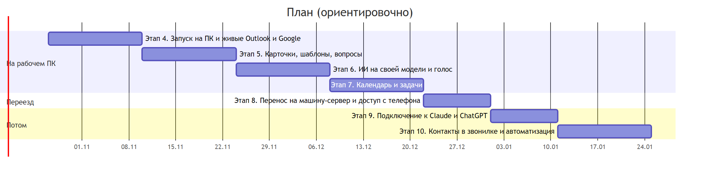

## Что появится на каждом этапе

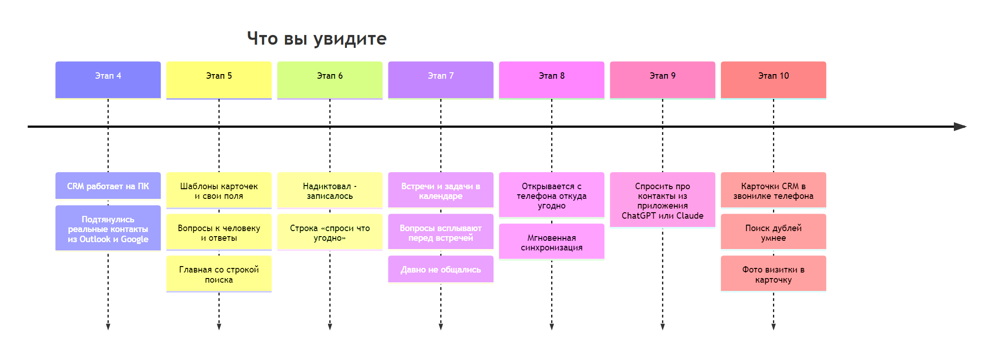

### Этап 4 — Запуск на рабочем ПК
- Вся система поднимается на этом компьютере одной командой.
- Регистрируем приложение в Microsoft и Google (бесплатно) и подключаем **ваши реальные** Outlook и Google.
- Проверяем, что контакты пришли правильно и без дублей.
- Резервная копия базы.

**Результат:** ваши настоящие контакты в CRM, правки уходят обратно в Outlook и Google.

### Этап 5 — Карточки и вопросы
- Шаблоны карточек (Клиент, Партнёр, Друг, Родственник, Сотрудник).
- Свои поля с типами: дата, список, ссылка и т. д.
- **Вопросы к человеку** и ответы.
- Новая главная со строкой поиска, «Недавние», «Дни рождения».

**Результат:** карточка, в которой есть всё нужное, без лишнего.

### Этап 6 — ИИ
- Подключаем свою модель Qwen.
- Строка «найти, спросить или записать» понимает обычный язык.
- Надиктовал или написал → предпросмотр → «Сохранить».
- Распознавание голоса.

**Результат:** заполнять формы больше не нужно.

### Этап 7 — Календарь и задачи
- Встречи и задачи из Outlook/Google, привязанные к людям.
- Создание встречи или задачи из карточки и голосом.
- Блок «Что спросить» в описании встречи и напоминание перед ней.
- «Давно не общались».

**Результат:** CRM сама готовит к встречам.

### Этап 8 — Переезд на машину-сервер
- Перенос всей системы и базы.
- Свой адрес в интернете (HTTPS) через защищённый туннель.
- Вход с телефона; сайт ставится на экран телефона как приложение.
- Мгновенная синхронизация с Outlook.

**Результат:** CRM всегда под рукой, на любом устройстве.

### Этап 9–10 — Потом
- Подключение CRM к приложениям ChatGPT/Claude (голосом с телефона).
- Контакты CRM в обычной звонилке телефона.
- Умный поиск дублей, «сменил работу», фото визитки → карточка.

## Что нужно для старта

| Что | От кого | Когда |
|---|---|---|
| Ответы в [анкете «да / нет»](#6-решения-да--нет) | Вы | Сейчас |
| Вход в Microsoft-аккаунт (Outlook) для регистрации приложения | Вы | Этап 4 |
| Вход в Google-аккаунт | Вы | Этап 4 |
| Данные о машине-сервере: видеокарта, версия Qwen | — | До этапа 6 |
| Доменное имя (адрес сайта) | Решить | До этапа 8 |


---

# 6. Решения: да / нет


> По каждому пункту отметить **Да** или **Нет**. Если «нет», то коротко — почему или как надо.
> В колонке «Предлагаю» — что сделаю по умолчанию, если ответа не будет.

## A. Главное

| # | Вопрос | Предлагаю | Да | Нет | Комментарий |
|---|---|---|---|---|---|
| A1 | Пользоваться будет один человек (без доступа сотрудникам и семье)? | Да | ☐ | ☐ | |
| A2 | Источники: Outlook + Google + телефон. Всё нужно? | Да, все три | ☐ | ☐ | |
| A3 | Нужен ли ещё какой-то источник (iCloud, WhatsApp, Telegram, 1С…)? | Нет | ☐ | ☐ | |
| A4 | Главный инструмент — компьютер, телефон — вторым? | Да | ☐ | ☐ | |
| A5 | Сначала делаем на рабочем ПК, потом переносим на машину-сервер? | Да | ☐ | ☐ | |

## B. Карточка человека

| # | Вопрос | Предлагаю | Да | Нет | Комментарий |
|---|---|---|---|---|---|
| B1 | Шаблоны «Клиент, Партнёр, Друг, Родственник, Сотрудник» подходят? | Да | ☐ | ☐ | Каких не хватает? |
| B2 | ИИ может предлагать **новые поля** сам (с подтверждением)? | Да | ☐ | ☐ | |
| B3 | Нужны связи между людьми («жена», «коллега», «познакомил»)? | Да | ☐ | ☐ | |
| B4 | Нужно хранить фото человека? | Да, из Outlook/Google | ☐ | ☐ | |
| B5 | Нужны теги, кроме категорий? | Да | ☐ | ☐ | |
| B6 | Нужно ли хранить документы и файлы в карточке (договоры, сканы)? | Нет, позже | ☐ | ☐ | |

## C. Вопросы к человеку

| # | Вопрос | Предлагаю | Да | Нет | Комментарий |
|---|---|---|---|---|---|
| C1 | Отдельный список «что хочу спросить» с ответами — нужен? | Да | ☐ | ☐ | |
| C2 | Перед встречей вопросы дописываются в описание встречи в Outlook? | Да | ☐ | ☐ | Участники встречи их **не видят**, если это ваша личная копия встречи — уточним на этапе 7 |
| C3 | Уведомление «через час встреча, вот вопросы»? | Да | ☐ | ☐ | За сколько минут? |
| C4 | ИИ сам закрывает вопрос, если в рассказе есть ответ (с подтверждением)? | Да | ☐ | ☐ | |

## D. Календарь и задачи

| # | Вопрос | Предлагаю | Да | Нет | Комментарий |
|---|---|---|---|---|---|
| D1 | Основной календарь — Outlook? | Да | ☐ | ☐ | Или Google? |
| D2 | Задачи — в Microsoft To Do (рядом с Outlook)? | Да | ☐ | ☐ | Или в календарь событиями? |
| D3 | Блок «Давно не общались» на главной? | Да | ☐ | ☐ | |
| D4 | Сроки по умолчанию: партнёры 2 мес, клиенты 1 мес, друзья 3 мес? | Да | ☐ | ☐ | |
| D5 | Напоминать о днях рождения за 3 дня? | Да | ☐ | ☐ | |

## E. ИИ

| # | Вопрос | Предлагаю | Да | Нет | Комментарий |
|---|---|---|---|---|---|
| E1 | ИИ — своя модель Qwen, данные не уходят в интернет? | Да | ☐ | ☐ | |
| E2 | ИИ **только предлагает**, сохраняете вы (кнопка «Сохранить»)? | Да | ☐ | ☐ | |
| E3 | Голосовой ввод нужен? | Да | ☐ | ☐ | |
| E4 | Запасной вариант через Claude (платно, данные уходят в США) — держать выключенным? | Да, выключен | ☐ | ☐ | |
| E5 | Хранить историю разговоров с ИИ? | Да, 3 месяца | ☐ | ☐ | |
| E6 | Позже — подключить CRM к приложению ChatGPT / Claude на телефоне? | Да, этап 9 | ☐ | ☐ | |

## F. Синхронизация и данные

| # | Вопрос | Предлагаю | Да | Нет | Комментарий |
|---|---|---|---|---|---|
| F1 | Правки в CRM отправлять обратно в Outlook и Google? | Да | ☐ | ☐ | |
| F2 | Если контакт удалён в Outlook — удалять и в CRM? | **Нет**, пометить «удалён в Outlook» | ☐ | ☐ | |
| F3 | Если в Outlook и в CRM разные значения — побеждает последнее изменение? | Да | ☐ | ☐ | Или спрашивать каждый раз? |
| F4 | Свои поля, вопросы и заметки — только в CRM (в Outlook не отправлять)? | Да | ☐ | ☐ | |
| F5 | Резервная копия каждую ночь? | Да | ☐ | ☐ | Куда: второй диск / облако? |

## G. Внешний вид

| # | Вопрос | Предлагаю | Да | Нет | Комментарий |
|---|---|---|---|---|---|
| G1 | Главная = строка поиска + «Сегодня» + ДР + «Давно не общались»? | Да | ☐ | ☐ | Что убрать или добавить? |
| G2 | Вкладки: Главная, Контакты, Вопросы, Календарь, Помощник? | Да | ☐ | ☐ | |
| G3 | Табличный вид контактов (как Excel)? | Да | ☐ | ☐ | |
| G4 | Тёмная тема? | Светлая + тёмная | ☐ | ☐ | |
| G5 | Отдельное приложение в App Store / Google Play? | Нет, сайт на экране телефона | ☐ | ☐ | |

## H. Не делаем (подтвердить)

| # | Что | Предлагаю | Да, не делаем | Нет, делаем |
|---|---|---|---|---|
| H1 | Подтягивать данные из LinkedIn (запрещено их правилами) | Не делаем | ☐ | ☐ |
| H2 | Чтение почты для автоматической истории общения | Не сейчас | ☐ | ☐ |
| H3 | Продажа CRM другим людям | Не сейчас, делаем для себя | ☐ | ☐ |
| H4 | Своя модель на арендованном сервере с видеокартой | Не делаем, есть своя машина | ☐ | ☐ |

---

## Свободные пожелания

_Что ещё обязательно должно быть? Что больше всего раздражает в Outlook сейчас?_

1.
2.
3.

